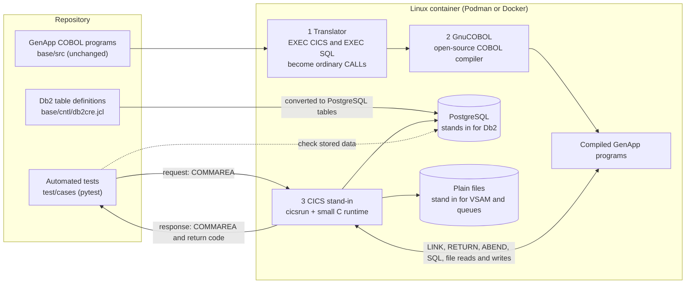

# General insurance application (GenApp) for IBM CICS TS

This GitHub repository contains the code originally distributed by the
IBM SupportPac CB12 (now removed).
The repository demonstrates application modernization for IBM CICS Transaction Server for
z/OS (CICS TS), by modeling a general insurance application.

## Application description

The primary purpose of this repository is to demonstrate application modernization, by providing a general insurance
application (known as GenApp) for IBM CICS Transaction Server for z/OS (CICS TS). GenApp has been developed in-house by
the IBM Hursley CICS Development team to help with their testing of new CICS releases.

GenApp is designed to exercise various components of CICS TS; containing functions to insert, query, and delete policy
information. In its original form GenApp is driven using 3270 input, where the insurance policy information is stored
in an IBM Db2 database.

GenApp illustrates how a 3270-based 'green screen' application can be transformed to use many of the rich features and
functions of the newer releases of CICS TS.

### GenApp base ([base/](base/README.md))

The general insurance application is a working COBOL application that you can use to try out different features of CICS,
including modernizing applications.

### Off-mainframe tests ([test/](test/README.md))

Compiles the GenApp COBOL programs with GnuCOBOL and runs automated tests against them on Linux, with emulated CICS commands
and PostgreSQL in place of Db2. Run `test/run.sh` (needs Podman or Docker). The tests also run in GitHub Actions on every pull request.
See [Testing without a mainframe](#testing-without-a-mainframe) for how it works.

## Testing without a mainframe

**The problem:** GenApp runs on z/OS, IBM's mainframe operating system. Its COBOL programs depend on three mainframe services:

- **CICS** (Customer Information Control System), the transaction server that starts the programs and connects them.
- **Db2**, IBM's relational database.
- **VSAM** (Virtual Storage Access Method), the mainframe's indexed file system.

Without a mainframe there is no way to run the programs, so no way to check that a change works.

**The idea:** keep the COBOL programs exactly as they are and replace everything *around* them with small open-source
stand-ins that behave the same way. Everything runs in one Linux container, on a laptop or in GitHub Actions.

1. **Translate.** On z/OS, precompilers turn the `EXEC CICS` and `EXEC SQL` blocks in the COBOL into calls to CICS and Db2.
   Our translator ([`test/tools/precompile.py`](test/tools/precompile.py)) does the same, but the calls go to the stand-ins.
2. **Compile.** GnuCOBOL compiles the translated programs, with the same number-handling rules as IBM's compiler.
3. **Run and check.** A test builds a COMMAREA (communication area, the fixed-layout record every GenApp program receives
   and returns), sends it to a program, and checks the return code, the returned fields, the database rows and the
   VSAM records.

| On the mainframe | In the test harness |
|---|---|
| CICS runs the programs and handles `LINK`, `RETURN`, `ABEND`, `SYNCPOINT` | `cicsrun` and a small C runtime do the same; an abend rolls back the database |
| CICS and Db2 precompilers | Translator script ([`test/tools/precompile.py`](test/tools/precompile.py)) |
| IBM Enterprise COBOL compiler | GnuCOBOL |
| Db2 database | PostgreSQL. Tables are generated from the same JCL (Job Control Language) file; Db2 error codes (SQLCODEs) and timestamp format are emulated |
| VSAM files `KSDSCUST`, `KSDSPOLY` | One file per record |
| TS / TD queues (temporary storage / transient data, e.g. the `CSMT` error log) | Text files |
| Users at a 3270 terminal | pytest tests calling the programs directly |

**Where it runs:**

- **Laptop:** `test/run.sh` builds the container, compiles all programs and runs the tests in seconds.
- **Every pull request:** the [GenApp tests](.github/workflows/genapp-tests.yml) workflow runs the same script and posts
  a results table. `main` only accepts pull requests whose tests pass.
- **Copilot coding agent:** [`copilot-setup-steps`](.github/workflows/copilot-setup-steps.yml) prepares the container, and
  [`copilot-instructions.md`](.github/copilot-instructions.md) tells the agent to follow the existing patterns and run
  the tests, so it can check its own COBOL changes before opening a pull request.

**What it proves, and what it doesn't:** the tests run the real program logic, COMMAREA layouts, SQL statements and return
codes, so they catch most mistakes in a change. They already found a real GenApp bug ([#4](https://github.com/jkordick/cics-genapp/issues/4)). They are
still not a mainframe: Db2 locking, EBCDIC (the mainframe's character encoding), 3270 screens and performance are not
covered. Passing tests are strong evidence, not proof. Run the real z/OS build and an integration test before production.

Details: [test/README.md](test/README.md).

## Possible Uses

To test a variety of functions and components of CICS TS, using a typical application. GenApp can be used to modify an
existing legacy application to utilize new CICS functions and capabilities.

## Skill level required

Intermediate, with knowledge of CICS systems configuration, operation, and applications.

## Prerequisites

* [IBM CICS Transaction Server for z/OS V4.1 or later](https://www.ibm.com/products/cics-transaction-server)
* [IBM Db2](https://www.ibm.com/analytics/db2)

The [off-mainframe tests](#testing-without-a-mainframe) need neither: Podman or Docker is enough.

For details of compatibility with CICS TS of the GenApp base application, or its extensions, consult the individual
component directories linked above.

## Change history and contributors

See the [change history](Changes.md) document for details of changes to this sample and a list of contributors to
the project.

## License

This sample is supplied under the [Eclipse Public License 2.0](LICENSE).

